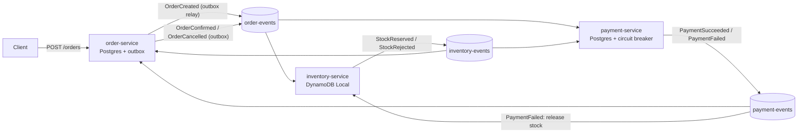

# Event-Driven Order Processing System

[](https://github.com/bhavingaikwad/event-driven-orders/actions/workflows/ci.yml)

Three Spring Boot services (order, inventory, payment) coordinate a purchase through Kafka using a saga with compensating actions. All Java 21.

The point of the project is not the happy path. It is what happens when things fail: Kafka goes down, a service is killed mid-burst, a message is delivered twice, a message can never be processed. Each of those was tested, and the results are below with their limits.

## Scope (read this first)

- **Simulated:** stock levels and payment outcomes (a configurable decline rate and a simulated gateway). There is no real payment gateway.
- **Real data:** order arrivals and basket contents come from the public Olist Brazilian e-commerce dataset (98,666 replayable orders). The dataset is not in this repository.
- **Not production:** the demo deployment is one EC2 instance with Docker Compose. Kafka is a single broker with replication factor 1, and DynamoDB is DynamoDB Local in Docker, not the AWS service.
- Every measured number comes from a single run on one MacBook Air unless stated. They are evidence, not benchmarks.

## Architecture



An order moves CREATED, then STOCK_RESERVED, then CONFIRMED. A stock rejection or a payment failure ends in CANCELLED, and a payment failure also releases the reserved stock (the compensating action).

## What makes it reliable

| Problem | Mechanism | Evidence |
|---|---|---|
| Event lost when Kafka is down (the dual-write problem) | Transactional outbox: the order and its event commit in one database transaction, and a relay publishes later | Kafka stopped 6 min 13 s: 40 of 40 orders accepted, backlog drained about 4 s after the broker returned (INC-001) |
| Same event delivered twice | Idempotent consumers: order-service records each saga step in `processed_events`; inventory and payment use stored decisions, unique keys and conditional writes | 5 duplicate PaymentFailed and 3 duplicate StockReserved injected: order, stock, outbox and payment rows unchanged |
| A saga step fails after an earlier one succeeded | Compensation: payment failure releases the stock reservation | Stock conservation checked per SKU after replays |
| Overselling | DynamoDB transactions with conditional writes | 20 concurrent orders for 5 units: 5 reserved, 15 rejected, stock never negative |
| A message keeps failing | Exponential backoff (0.5 s to 5 s, 6 retries), then a `<topic>.DLT` dead-letter topic; `dlq-tool` lists and replays | Retry exhaustion landed in the DLT; replay reached CONFIRMED and was recognised as a duplicate |
| A dependency is down or slow | Circuit breaker around the simulated gateway (opens on failures or slow calls, then half-open probes) | 6 of 6 orders cancelled fast with no gateway calls while open; recovery to CLOSED observed |

Delivery is at-least-once, not exactly-once. Safety comes from idempotent handling.

## Measured results

All single runs on one laptop with simulated stock and payments.

| What | Result |
|---|---|
| Tests | 105 (104 run, 1 end-to-end test gated by `E2E=true`). Integration tests use real Kafka, Postgres 16 and DynamoDB Local through Testcontainers |
| Line coverage | order-service 87.7%, payment-service 84.8%, inventory-service 82.4%, contracts 95.2% (line coverage, not a measure of test quality) |
| CI | GitHub Actions runs the full `mvn verify` on every push; one successful run took 2 m 27 s |
| Load (open-loop k6, 100 orders/s for 60 s) | 6,000 orders accepted, 0 failed requests, API acceptance p95 18.4 ms. All 6,000 reached CONFIRMED or CANCELLED with distinct payments. Outbox backlog reached at least 2,710 rows and drained in 32 s, consistent with the relay being the first bottleneck (not proven by per-stage timing) |
| Real-data replay (Olist busiest day, 1,166 orders, 3600x speed) | p95 time to final status fell from about 12 s to about 1.1 to 1.4 s after the relay was measured, modelled and tuned |
| Chaos drills | Four failures (Kafka down, payment-service down, order-service `kill -9`, Postgres down) with incident reports in [`docs/incidents/`](docs/incidents/) |
| AWS demo | One run on EC2: the same black-box test gave 10 confirmed, 20 cancelled, 0 unfinished for 30 concurrent orders on 10 units of stock |

Details, caveats and what was not measured are in [PROGRESS.md](PROGRESS.md) and [RESUME_FACTS.md](RESUME_FACTS.md).

## Known limitations

- Orders that never receive an event stay CREATED (no timeout or reaper).
- Retries block the partition while they run; a long database outage delays everything behind it. Outages longer than about 90 s were not tested.
- No alerts on outbox backlog, consumer lag or dead-letter size.
- Inventory and payment publish to Kafka directly after their own write (no outbox there), so they rely on idempotent consumers.
- `processed_events` has no purge job. Circuit breaker state is in memory per instance.
- `PUT /admin/stock` has no authentication; the AWS demo restricts it by security group to one IP address.
- A crash after Kafka accepts a row but before it is marked sent can resend it. The window was not measured.
- Health checks hang when the database is down.

## Run it locally

Needs Java 21, Maven and Docker.

```bash
docker compose up -d                 # Kafka, Postgres, DynamoDB Local
mvn -B -ntp -DskipTests package
# each in its own terminal, from the module directory (logs go to ./logs)
cd order-service     && java -jar target/order-service-*.jar      # :8081
cd inventory-service && java -jar target/inventory-service-*.jar  # :8082
cd payment-service   && java -jar target/payment-service-*.jar    # :8083
```

Try an order (inventory seeds `sku-1`, `sku-2` with 1000 units and `sku-scarce` with 5):

```bash
curl -s -X POST localhost:8081/orders -H 'Content-Type: application/json' \
  -d '{"customerId":"c1","customerRegion":"US","currency":"USD","items":[{"sku":"sku-1","quantity":1,"unitPrice":10.0}]}'
curl -s localhost:8081/orders/<id-from-the-response>
```

Optional observability (Prometheus, Grafana, Jaeger; local-only credentials):

```bash
docker compose -f docker-compose.observability.yml up -d
# Grafana http://localhost:3000, Jaeger http://localhost:16686, Prometheus http://localhost:9090
```

## Test and reproduce

```bash
mvn -B -ntp verify                                         # all tests (Docker required)
E2E=true mvn -pl replay-tool test -Dtest=EndToEndTest      # black-box invariant against a running stack
k6 run --quiet -e RATE=100 -e DURATION=60s loadtest/orders.js
```

Seed stock before the load test: `PUT /admin/stock {"load-1":1000000}` on inventory-service. The Olist replay tool is the `replay-tool` module.

## AWS demo deployment

[`terraform/`](terraform/) builds a throwaway single-instance environment in us-east-2: one EC2 instance running Docker Compose and the three services, in the default VPC.

- Only one IP address (`/32`) can reach ports 8081 to 8083; there is no SSH port.
- The instance terminates itself after 240 minutes, and `terraform destroy` removes everything.

```bash
cd terraform
terraform init
terraform apply -var "my_ip_cidr=$(curl -s https://checkip.amazonaws.com)/32"
terraform destroy -var "my_ip_cidr=$(curl -s https://checkip.amazonaws.com)/32"
```

It was applied and destroyed once; it is not left running. It uses your AWS account and costs money while it exists.

## Design decisions and operations

- [Architecture decision records](docs/adr/README.md): circuit breaker fail-fast, blocking retries then dead letter, dedupe on business identity, no outbox in inventory and payment.
- [Runbook](docs/runbook.md): what to check and do for each failure that was drilled.
- [Incident reports](docs/incidents/): four chaos drills with hypothesis, timeline and measured results.

## Repository layout

| Path | Purpose |
|---|---|
| `contracts` | Event records and the envelope shared by all services |
| `order-service` | REST API, order state machine, outbox relay, saga consumer |
| `inventory-service` | Stock reservation and release in DynamoDB |
| `payment-service` | Simulated payments with a circuit breaker |
| `dlq-tool`, `replay-tool` | Dead-letter list and replay, and Olist replay with the black-box test |
| `loadtest` | k6 open-loop load script |
| `observability` | Prometheus config and the Grafana dashboard |
| `terraform` | AWS demo environment |
| `docs/incidents` | Chaos drill reports |

## Event contracts

Shared in the `contracts` module as plain Java records. Every event travels inside an `EventEnvelope`
(eventId, eventType, schemaVersion, correlationId, occurredAt, producer, payload).
Topics: `order-events`, `inventory-events`, `payment-events`. Records are keyed by `orderId`.

Versioning rule:
- Adding an optional field keeps the same schemaVersion; consumers ignore unknown fields.
- Removing, renaming or retyping a field is breaking: new payload class, schemaVersion + 1,
  and the producer publishes both versions until consumers have migrated.
